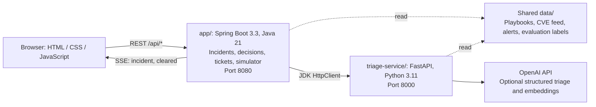
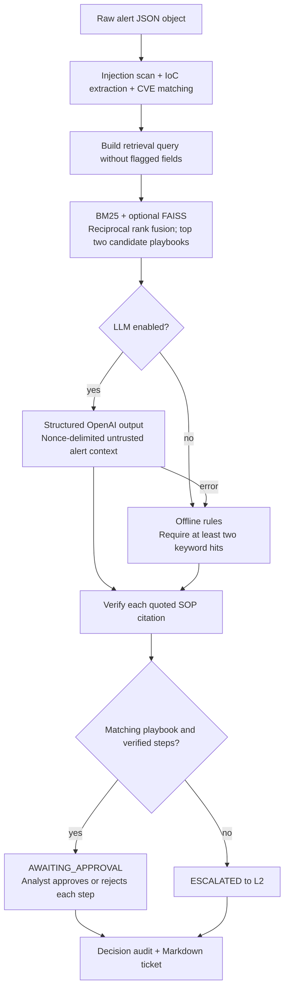

# Aegis SOC Copilot

Aegis turns a raw security alert into an analyst-reviewed incident: classification, severity, indicators, local CVE matches, and containment guidance grounded in approved SOC playbooks. Built for the TCS OpenAI Hackathon, problem 4A, it pairs a Java incident dashboard with a Python triage service. Its central safeguard is executable: a proposed step reaches the checklist only after its quote is verified against the cited playbook section. Suspicious instructions embedded in alerts are surfaced as tampering attempts, and alerts without usable guidance are routed to L2.

## Features

- **Live incident workspace:** SSE updates, newest/severity sorting, a time-to-contain timer, severity labels, incident evidence, and an audit trail.
- **Grounded response:** five playbooks covering phishing, ransomware, credential stuffing, DDoS, and public S3 buckets; 37 approved sections in the current dataset.
- **Citation verification:** checks section existence, allowed playbook membership, normalized quote length and substring match, and duplicate steps. Section titles and approval flags come from the playbook files.
- **Prompt-injection detection:** scans nested alert fields; excludes flagged fields from retrieval; encloses all alert-derived LLM context in random nonce markers. Detected injection raises severity one level, capped at CRITICAL.
- **Hybrid retrieval:** BM25 plus optional normalized FAISS embeddings, fused with reciprocal ranks. Embeddings are cached locally; embedding errors leave BM25 available.
- **Human decisions:** approve or reject pending steps using the analyst name, with timestamps and an audit log. High-impact actions carry an approval marker.
- **Threat context:** IPv4, hashes, URLs, emails, CVE IDs, and named asset indicators; keyword/ID matching against six real CVEs in a local feed. Matches are investigative leads, not confirmation that a host is vulnerable.
- **Incident tickets:** generate Markdown, preview it in a dialog, copy it, or download it.
- **Repeatable evaluation:** ten labeled alerts, four evaluation workers, classification/injection/escalation metrics, retrieval recall at 1 and 3, and citation pass rates.
- **Offline operation:** rule-based triage when no API key is present, and an explicit fallback with `error` populated if the LLM call fails.

## Architecture





The two services exchange camelCase JSON. The Java application owns incident state; Python returns triage recommendations. Incidents live in memory and are lost on restart. The application records decisions; it does not execute EDR, identity, firewall, or cloud changes. The current lifecycle marks an incident `CONTAINED` after every step has an APPROVED or REJECTED decision; this status does not attest that an external action was executed.

## Run locally

Install **Java 21**, **Maven 3.6.3+**, and **Python 3.11**. No frontend build tool is needed. The commands below assume a POSIX shell and a checkout containing the shared `data/` directory.

### Start after moving or renaming the folder

From the project directory, run:

```bash
./run-local.sh --check
./run-local.sh
```

The launcher resolves paths from its own location, selects the bundled Java 21 and Maven when available, builds the app, and starts both services. It works when called from another working directory, including when the project path contains spaces. Ctrl+C stops both processes. Existing services must be stopped before another copy can use the same ports.

Use `./run-local.sh triage` or `./run-local.sh app` to run one service in a terminal. OpenAI settings are inherited from your terminal; without an API key the triage service runs offline. Keys are never stored by the launcher. Optional `AEGIS_APP_PORT` and `AEGIS_TRIAGE_PORT` overrides default to 8080 and 8000.

Python virtual environments contain absolute activation paths. If you move this project again and activation or pip reports the previous location, recreate `.venv` in the new folder and reinstall requirements with its Python interpreter. The launcher uses `python -m uvicorn` to avoid stale console-script paths.

### 1. Start Python triage

From the repository root:

```bash
cd triage-service
python3.11 -m venv .venv
source .venv/bin/activate
python -m pip install -r requirements.txt
AEGIS_DATA_DIR=../data python -m uvicorn app.main:app --host 127.0.0.1 --port 8000
```

Without `OPENAI_API_KEY`, the service uses BM25 and conservative offline rules. To enable OpenAI, set the key in this terminal's environment before starting Uvicorn. The optional model variables are `OPENAI_MODEL` (default `gpt-4o-mini`) and `OPENAI_EMBEDDING_MODEL` (default `text-embedding-3-small`). The key is read by Python only.

Check [Python health](http://localhost:8000/health); the current data should report 5 playbooks, 37 sections, and 6 CVEs. Relative `AEGIS_DATA_DIR` paths resolve from `triage-service/` regardless of the shell's working directory. The local Uvicorn command sets its port explicitly; changing `PORT` alone does not change that command's `--port` argument.

### 2. Start the Java app

In a second terminal, from the repository root:

```bash
cd app
AEGIS_ENGINE=http TRIAGE_SERVICE_URL=http://localhost:8000 \
  AEGIS_DATA_DIR=../data mvn spring-boot:run
```

Open [Aegis](http://localhost:8080). The sidebar should show `http` and the Python retrieval mode. `PORT` changes the Java server port; its default is 8080.

For a UI-only demo, start Java with `AEGIS_ENGINE=fake` instead. Fake is the default: it returns ransomware for EDR, a tampering escalation for WAF, and phishing for other sources. It reads local playbooks to produce verified canned citations. These are demo responses, not the Python classifier. Evaluations and Playbooks still need Python because their endpoints are proxied; 404/503 responses show **Triage service not connected yet**.

### Configuration

| Variable | Service | Default / use |
| --- | --- | --- |
| `OPENAI_API_KEY` | Python | Optional; enables structured LLM triage and embedding attempts |
| `OPENAI_MODEL` | Python | `gpt-4o-mini` |
| `OPENAI_EMBEDDING_MODEL` | Python | `text-embedding-3-small` |
| `OPENAI_MAX_COMPLETION_TOKENS` | Python | `4096`; one retry uses twice this budget (valid initial range: 512–16384) |
| `AEGIS_DATA_DIR` | Both | `../data` locally; `/srv/data` in the Docker images |
| `AEGIS_ENGINE` | Java | `fake`; set `http` to call Python |
| `TRIAGE_SERVICE_URL` | Java | `http://localhost:8000`, without an API path suffix |
| `PORT` | Both containers | Java defaults to 8080; Python Docker startup defaults to 8000 |

The simulator also accepts the Spring property `aegis.data-dir`, with `aegis.datadir` as a compatibility fallback. Use the shared environment variable to keep the app's data readers aligned.

### Tests

```bash
# From triage-service/, with its virtual environment active:
AEGIS_DATA_DIR=../data python -m pytest -q

# From app/, with Java 21 selected:
mvn -q test

# Optional frontend regression tests, from app/, if Node.js is installed:
node src/test/js/app.test.cjs
```

GitHub Actions runs separate Java 21 and Python 3.11 jobs on pushes and pull requests. Python tests remove inherited OpenAI credentials and mock API calls. Maven uses `app/.tools/m2` locally; CI overrides that location to use the repository cache supplied by `setup-java`.

## Deploy on Render

Create two Docker services from the same Git repository. **Keep Root Directory blank and Docker Build Context at `.` for both.** Each Dockerfile copies shared `data/` from the repository root. Set the Dockerfile Path per service, as supported by [Render's Docker deployment settings](https://render.com/docs/docker).

| Setting | Triage service | App service |
| --- | --- | --- |
| Service type | Private Service | Web Service |
| Language/runtime | Docker | Docker |
| Dockerfile Path | `triage-service/Dockerfile` | `app/Dockerfile` |
| Docker Build Context | `.` | `.` |
| Region/workspace | Same as app | Same as triage |
| `PORT` | `8000` | `8080` |
| `AEGIS_DATA_DIR` | `/srv/data` | `/srv/data` |
| Health check | `/health`, where configurable | `/api/status` |
| Other environment | Optional `OPENAI_API_KEY`, model variables | `AEGIS_ENGINE=http`; `TRIAGE_SERVICE_URL=http://INTERNAL_HOST:8000` |

Deploy Python first. Copy its actual internal hostname from Render's **Connect → Internal** menu and substitute it for `INTERNAL_HOST` in the app's environment. Same-workspace services in the same region can communicate over Render's [private network](https://render.com/docs/private-network); use the provided hostname rather than assuming the display name is resolvable. Use the Dockerfiles' default startup commands. Both listen on the configured port, and both images include their own copy of the shared data.

Deploy Java and open its public URL. Verify `/api/status` shows `triageMode: "http"` and a non-null, healthy `triageService`, then load Playbooks and run an evaluation. The app's status route itself can return 200 while Python is unavailable, so inspect the nested service health during deployment checks.

There is no `render.yaml` in the current repository; use the dashboard settings above. Deploy a single app instance because incident storage and SSE subscriptions are process-local. Restarting or redeploying it clears incidents. Treat this as a demonstration deployment: the current API has no authentication and approval names are analyst-entered labels. Store an optional API key as a Render environment secret on the Python service.

To check the images locally, run these builds from the repository root:

```bash
docker build -f triage-service/Dockerfile -t aegis-triage .
docker build -f app/Dockerfile -t aegis-app .
docker network create aegis-demo
docker run --rm --name aegis-triage --network aegis-demo -p 8000:8000 aegis-triage
```

In another terminal:

```bash
docker run --rm --name aegis-app --network aegis-demo -p 8080:8080 \
  -e AEGIS_ENGINE=http -e TRIAGE_SERVICE_URL=http://aegis-triage:8000 aegis-app
```

## API

Alert inputs are arbitrary JSON **objects**; arrays and scalar bodies are rejected. Responses use camelCase. Triage results separate actionable `steps` from `rejectedSteps`; incidents assign zero-based indices to their decision steps.

### Java app — port 8080

| Method | Path | Behavior |
| --- | --- | --- |
| GET | `/api/status` | Engine mode, Python health or null, sample filenames, incident statistics |
| POST | `/api/alerts` | Ingest an alert; return an Incident with 202, triage asynchronously |
| POST | `/api/triage` | Synchronous TriageResult; creates no incident |
| POST | `/api/simulate?gapSeconds=4` | Schedule demo alerts; 202 with `scheduled` and `gapSeconds`; results arrive over SSE |
| GET | `/api/incidents` | Incidents, newest first |
| GET | `/api/incidents/{id}` | One Incident |
| POST | `/api/incidents/{id}/steps/{index}/approve?analyst=NAME` | Approve a pending step on an incident awaiting approval |
| POST | `/api/incidents/{id}/steps/{index}/reject?analyst=NAME` | Reject a pending step; decision is audited |
| GET | `/api/incidents/{id}/ticket` | Markdown incident ticket, `text/markdown` |
| POST | `/api/incidents/clear` | Stop scheduled demo alerts, clear incidents, publish `cleared` |
| GET | `/api/stream` | `text/event-stream`, named `incident` and `cleared` events |
| GET | `/api/samples/{file}` | Raw sample JSON; traversal-style filenames are rejected |
| GET | `/api/playbooks` | Forward Python playbooks response unchanged |
| POST | `/api/eval` | Forward Python evaluation response unchanged |

Unknown incidents or steps return 404; invalid arguments or state transitions return 400, with `{"error":"message"}`. An unreachable proxy target returns 503 with `{"error":"Triage service unavailable"}`. Approval is a decision record and does not invoke an external containment system.

### Python triage — port 8000

| Method | Path | Behavior |
| --- | --- | --- |
| GET | `/health` | `status`, triage `mode`, `retrievalMode`, playbook/section/CVE counts |
| POST | `/triage` | Alert JSON object → TriageResult |
| GET | `/playbooks` | All playbooks and sections with authoritative approval flags |
| GET | `/retrieve?q=...&k=5` | Ranked sections, titles, fused scores, BM25/vector ranks; `k` is 1–100 |
| POST | `/eval` | `{summary, cases}` for the configured evaluation set |

Evaluation reports classification, injection-detection and escalation accuracy; injection recall and false positives; retrieval recall at 1 and 3; verified/proposed steps; average triage milliseconds; and per-case errors. Retrieval recall excludes cases whose expected playbook is `NONE`. The current offline rules can escalate supported attack types when keyword evidence is insufficient; the report exposes those misses rather than substituting canned outcomes.

Example, from the repository root while both services are running:

```bash
curl -sS http://localhost:8080/api/status
curl -sS -X POST http://localhost:8080/api/alerts \
  -H 'Content-Type: application/json' --data-binary @data/alerts/ransomware-01.json
curl -sS -X POST http://localhost:8080/api/eval
```

## Three-minute demo

Use both services with `AEGIS_ENGINE=http`; start Python without a key for a reproducible offline run, or with a valid environment key for the LLM path. Enter an analyst name before presenting. Use the UI-only fake engine separately if you want to demonstrate its deliberately rejected ransom instruction.

| Time | Action | What to show |
| --- | --- | --- |
| 0:00–0:25 | Open Live feed and point to the sidebar modes. Click **Simulate attack**. | Six samples arrive four seconds apart, ordered phishing, credential stuffing, ransomware, injection, S3, DDoS. Explain the approval boundary. |
| 0:25–1:05 | Select the ransomware incident for `FIN-WS-042`. | CRITICAL severity, `svc-backup`, `203.0.113.47`, Citrix Bleed, PB-02 quotes, approval labels, and the live time-to-contain timer. Expand retrieval evidence. |
| 1:05–1:30 | Select the WAF injection incident. | The red tampering banner, the `note` finding, severity raised to CRITICAL in the Python flow, and L2 escalation. Alert instructions do not close the incident. |
| 1:30–1:55 | Return to ransomware and record the pending decisions. | Each decision updates the audit trail; the final decision changes the status to CONTAINED and freezes the timer. No external containment action is executed. |
| 1:55–2:20 | Click **Generate incident ticket**, then copy or download it. | Markdown evidence, CVE remediation, SOP references, decisions, and audit history. Point to the Hallucination guard if steps were rejected; Python may reject none on a particular run. |
| 2:20–3:00 | Run **Evaluations**, then open **Playbooks**. | Honest labeled-case results, injection recall, retrieval recall at 1/3, citation pass rate, and orange approval sections. An LLM evaluation may take about a minute; start it earlier or present the completed report if needed. |

## Screenshots

No `docs/` directory or screenshot files are currently present in the repository, so this README has no embedded screenshot links. The capture checklist for a future `docs/` gallery is the live feed at 1366×768, the ransomware checklist and open Hallucination guard at 1280×800, the injection escalation, the evaluation report, and the Markdown ticket dialog. Local previews under `app/target/` are build artifacts and are not a committed screenshot gallery.
